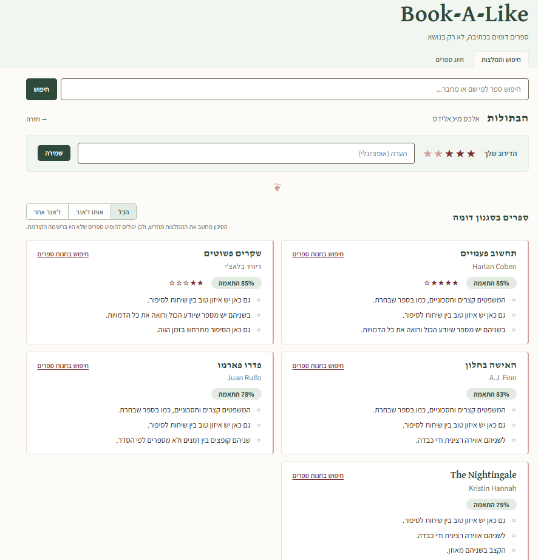

# Book-A-Like

**ספרים דומים בכתיבה, לא רק בנושא**
*(Books written alike, not just about the same thing.)*

*(Repository name: `book-style-recommender`.)*



A book recommendation engine that suggests books by **how they're written**,
not by genre or topic. Search for a book you liked and get back books with a
similar writing style - sentence length, amount of dialogue, point of view,
tone, pacing, and so on - even when they sit in a completely different genre.
Every recommendation comes with a short, plain-language explanation of why it
matched, and a link to look the book up in a bookstore. Genre is shown as
information and can optionally filter results, but it never drives the match
itself (see `DECISIONS.md`).

## Current state

- **136 books** in the working catalog: **36 tagged by hand** and **100 tagged
  automatically with Gemini** (see [LLM auto-tagging](#llm-auto-tagging)).
- **Style similarity** over 10 hand-defined attributes, with a hand-written
  weighted distance function - no embeddings. Each recommendation's
  explanation is built from the three attributes where the two books are
  closest, in natural Hebrew ("המשפטים קצרים וחסכוניים, כמו בספר שבחרת.").
- **Personal ratings:** 1-5 stars and an optional note per book, shown next to
  the book in recommendations. A rating never changes a book's score or
  position - style similarity and "did I like it" are kept apart.
- **A designed Hebrew interface (RTL):** search, a book view with its
  recommendations, book-to-book navigation (open a recommended book to see
  its own recommendations), working browser Back/Forward, and a tagging
  screen for adding and tagging books by hand. Keyboard-accessible, with
  `prefers-reduced-motion` respected.

## How this was built

This project was built with Claude Code as a coding assistant, under working
rules set before any code was written:

- A plan had to be presented and approved before implementation.
- Files were approved one at a time - no jumping ahead to the next file.
- No new dependency without a stated justification.
- Every architectural decision is recorded in `DECISIONS.md`, including the
  alternatives that were rejected and why.

Every line was reviewed before it went into the repo. `DECISIONS.md` is the
record of the reasoning behind this codebase, not just its current state.
`EVALUATION.md` is the record of how far the automatic tagging can be trusted,
including the negative results.

## Stack

- Backend: Python + FastAPI
- Database: PostgreSQL (via Docker)
- Frontend: React (plain JavaScript, no UI library, plain CSS) built with Vite
- LLM auto-tagging: Google Gemini via the official `google-genai` SDK (terminal
  scripts only - the API server never calls it)
- Testing: pytest (backend, dev dependency)

## Architecture - how a request flows

The browser loads the React app from Vite (`http://localhost:5173`). React
calls the backend at `VITE_API_URL` (`http://localhost:8000`) with `fetch`.
FastAPI opens a `psycopg` connection (`backend/db.py`) and queries PostgreSQL
with plain SQL; for recommendations it also runs `backend/similarity.py` over
every tagged candidate, sorts by score, and returns the top results with
their explanations. React renders the JSON it gets back.

The frontend has no router: the main screen switches between its views (home,
results, a book) in React state, and uses the browser's History API
(`pushState` / `popstate`) so Back and Forward work (see `DECISIONS.md`).

## Setup (from scratch)

### Prerequisites

- Docker Desktop (for the database)
- Python 3.11+
- Node.js 22.12+ (the machine this was built on has Node 24)

### 1. Environment files

There are **two separate `.env` files** - the backend and frontend never
share environment variables (see `DECISIONS.md`).

Backend + database, at the repo root:

```bash
cp .env.example .env
```

Then edit `.env`: set a real `POSTGRES_PASSWORD`, and update the password in
`DATABASE_URL` to match. `GEMINI_API_KEY` is only needed for the
auto-tagging scripts; the app runs without it.

Frontend, inside `frontend/`:

```bash
cp frontend/.env.example frontend/.env
```

The default `VITE_API_URL` already points at the local backend; no edit needed.

### 2. Database

```bash
docker compose up -d
```

Starts PostgreSQL on `localhost:5432`. **On the container's first-ever start**
(empty data volume), Postgres also runs `db/schema.sql` then `db/seed.sql`
automatically, creating the tables and loading **15 demo books** (14 tagged,
1 left untagged on purpose). Data then persists in a named Docker volume
between runs.

A fresh install starts from these 15 books, not the full 136-book working
catalog. To grow it: add and tag books by hand in the app's tagging screen,
and/or run `backend/add_books_bulk.py` to add the 100 curated books in
`backend/books_to_add.json` with Gemini tagging (needs `GEMINI_API_KEY`; see
[LLM auto-tagging](#llm-auto-tagging)).

If you edit `db/schema.sql` or `db/seed.sql` and need them to run again, wipe
the volume first:

```bash
docker compose down -v
docker compose up -d
```

`down -v` also removes all data, so use it only in development.

### 3. Backend

```bash
cd backend
python -m venv .venv
# Windows:
.venv\Scripts\activate
# macOS / Linux:
source .venv/bin/activate

pip install -r requirements.txt
uvicorn main:app --reload
```

The API runs on `http://localhost:8000`. Check it:

```bash
curl http://localhost:8000/health
# {"status":"ok"}
```

Interactive docs (try every endpoint from the browser): `http://localhost:8000/docs`.

### 4. Frontend

In a separate terminal:

```bash
cd frontend
npm install
npm run dev
```

Open `http://localhost:5173`. The home screen explains how it works and offers
three example books to try in one click.

## LLM auto-tagging

Tagging 10 style attributes by hand doesn't scale to a big catalog, so the
backend includes terminal scripts that ask Gemini to tag a book (run from
`backend/`, with the API server running):

| Script | What it does |
| --- | --- |
| `python tag_with_llm.py <book_id>` | Tags one book and saves it (`tagged_by = 'llm'`). |
| `python add_books_bulk.py` | Adds the books in `books_to_add.json` and tags them. Safe to re-run - the database is the progress record, so it only does the work still left. |
| `python compare_llm_tagging.py` | Measures how well Gemini agrees with the hand-tagged books (compares only `tagged_by = 'manual'`). `--report-only` reprints the last run with no Gemini calls. |

**How far it can be trusted is measured, not assumed - see `EVALUATION.md`.**
In short:
- Attributes with strong surface signals (point of view, sentence length,
  humor) agree with the hand tags 80%+ of the time. The 1-5 numeric attributes
  are usually within one point.
- **Present tense is not trusted from the LLM at all.** On 8 hand-verified
  books the model was wrong 8/8, and giving it the original English title
  didn't help (0/8). It's tagged by hand only, and stored as unknown (`NULL`)
  for LLM-tagged books, where the similarity function leaves it out.
- The model can't tag books it doesn't know: niche local titles and very
  recent releases come back as "unknown" and need tagging by hand.
- Each row records who tagged it (`tagged_by`: `manual` or `llm`).
- The free Gemini tier allows about 20 requests a day, so a 100-book run takes
  several days. The bulk script picks up where it left off.

## Testing

```bash
cd backend
pip install -r requirements-dev.txt   # pulls in requirements.txt too
pytest
```

20 tests on `similarity.py` (pure Python, no database needed): the
per-attribute distance rules, unknown (`None`) attributes being left out of
the score and the explanation, the exact explanation wording, and a regression
test tied to the real seed data. The API endpoints are verified against the
running server (through `/docs` and throwaway test rows) - there are no
automated tests for the database-backed routes yet.

## API

| Method | Path | What it does |
| --- | --- | --- |
| `GET` | `/health` | Liveness check. |
| `GET` | `/books?search=&limit=&offset=` | Search by title/author prefix (case-insensitive). Empty `search` returns the whole catalog. `limit` is capped at 100 - callers page with `offset`. Each book includes `is_tagged`. |
| `GET` | `/books/{id}` | One book's metadata, its style attributes (including `tagged_by`) if tagged, and `rating` (`null` if unrated). `404` if the id doesn't exist. |
| `GET` | `/books/{id}/recommendations?genre=&limit=` | The most style-similar tagged books, each with a `similarity_score`, a `rationale` (three plain-language sentences), a `bookstore_search_url`, and the book's `rating`. `genre` is `any` (default), `same`, or `different` - it changes which candidates are considered, never the score. `404` if `{id}` doesn't exist, `409` if it isn't tagged yet. |
| `POST` | `/books` | Adds a book (`title`, `author`, `language`, optional `title_original` and `genre`). `409` if the same title and author already exist. |
| `PUT` | `/books/{id}/style-attributes` | Saves or replaces a book's 10 style attributes, plus `tagged_by` (`manual` or `llm`, required). |
| `PUT` | `/books/{id}/rating` | Saves or replaces a 1-5 `rating` with an optional `note`. Any book can be rated, tagged or not. |

Example:

```bash
curl "http://localhost:8000/books/1/recommendations?limit=3"
```

## Not built yet

- **No real Open Library integration** - book metadata is entered by hand or
  from `books_to_add.json`, with placeholder ids and no cover images.
- **Similarity weights are still the equal-weight v1 baseline.** Tuning waits
  for a real test set. Learning weights from ratings is planned after about 20
  ratings.
- **No users or login** - ratings belong to a single reader.
- **No automated tests for the API endpoints**, only for `similarity.py`.
- **A book view has no URL of its own** - reloading the page returns to the
  home screen, and a specific book can't be linked to.

## Ports

| Service    | URL                     |
| ---------- | ----------------------- |
| Frontend   | http://localhost:5173   |
| Backend    | http://localhost:8000   |
| PostgreSQL | localhost:5432          |

## Project layout

```
backend/                    FastAPI server + terminal scripts
  main.py                   the API (search, book detail, recommendations, add, tag, rate)
  db.py                     opens a psycopg connection from DATABASE_URL
  schemas.py                request validation shared by the API and the LLM scripts
  similarity.py             the style-similarity function and explanation wording (pure Python)
  test_similarity.py        tests for similarity.py (pytest)
  llm_tagging.py            asks Gemini to tag one book, validates the answer
  tag_with_llm.py           script: tag one book with Gemini
  add_books_bulk.py         script: add + tag the books in books_to_add.json
  compare_llm_tagging.py    script: measure Gemini against the hand tags
  api_client.py             HTTP helpers the scripts use to call the API
  books_to_add.json         100 curated books for the bulk script
  requirements.txt          runtime dependencies
  requirements-dev.txt      + pytest, for running tests
db/                         database setup, run by docker-compose on first start
  schema.sql                tables: books, book_style_attributes, book_ratings
  seed.sql                  15 demo books (14 tagged, 1 deliberately untagged)
frontend/                   Vite + React app
  index.html                entry HTML (Hebrew, RTL, fonts)
  src/main.jsx              mounts React, loads the base styles
  src/App.jsx               header, screen tabs
  src/api.js                API base URL and the paging helper
  src/styles/base.css       design tokens, typography, shared element styles
  src/components/           one component per file, each with its own CSS
docs/                       README assets (screenshot)
docker-compose.yml          PostgreSQL, seeded from db/ on first start
DECISIONS.md                architecture decision log
EVALUATION.md               how far the LLM auto-tagging can be trusted
HANDOFF.md                  project state written before the 3-week break (historical)
```
